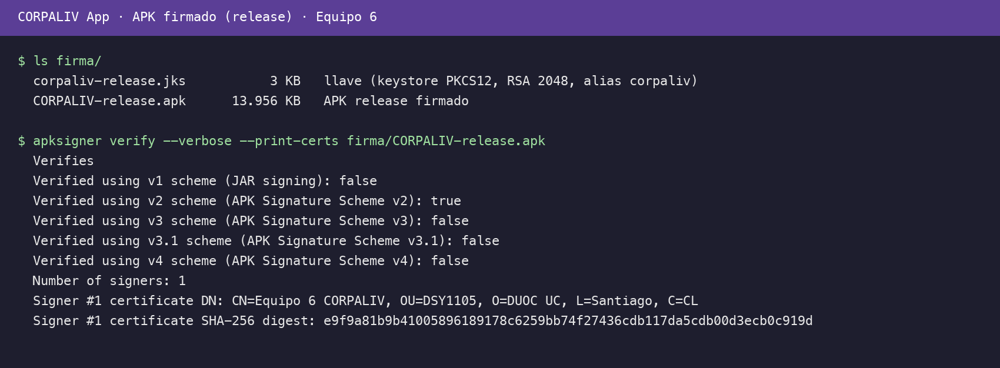

# CORPALIV App

App Android para CORPALIV y su red sociolaboral Alba Lab: muestra el impacto de la organización, sus programas y productos, y convierte el interés de empresas y donantes en solicitudes de colaboración.

DSY1105 – Desarrollo de Aplicaciones Móviles (DUOC UC) · Equipo 6

## Integrantes

- Alejandro Cuitiño
- Maximiliano Córdova

## Arquitectura

```
App Android (Kotlin, Compose, MVVM) ──Retrofit──► ms-contenido   (8081) ─┐
          │                         ──Retrofit──► ms-solicitudes (8082) ─┴─► PostgreSQL (Supabase)
          ├── Room + DataStore (usuarios, sesión y copia local de solicitudes)
          └── Retrofit ──► mindicador.cl (API externa)
```

| Módulo | Ruta | Stack |
|---|---|---|
| App | `app/` | Kotlin, Jetpack Compose, Material 3, MVVM, StateFlow, Navigation, Room, DataStore, Retrofit + Gson |
| ms-contenido | `backend/ms-contenido/` | Spring Boot 4, Kotlin, Spring Data JPA, Bean Validation |
| ms-solicitudes | `backend/ms-solicitudes/` | Spring Boot 4, Kotlin, Spring Data JPA, Bean Validation |
| Base de datos | Supabase | PostgreSQL. Tablas creadas por `schema.sql` de cada microservicio, con RLS activo |

## Funcionalidades

- Registro e inicio de sesión: validaciones, edad calculada desde la fecha de nacimiento y clave con hash PBKDF2 + sal.
- Inicio con indicadores de impacto animados e historia anonimizada.
- Programas y Catálogo desde `ms-contenido`. "Lo quiero" abre el formulario con Compra de productos.
- Colaborar: 5 modalidades con el destino de cada aporte.
- Solicitud de interés con CRUD completo contra `ms-solicitudes`: crear, listar, editar y eliminar.
- Mis solicitudes se actualiza cada 5 s; los cambios hechos en la base se ven en la app.
- Equivalencia del monto en UF y dólares con la API externa mindicador.cl.
- Recursos nativos: cámara (foto de perfil) y ubicación (sede más cercana), con permisos en tiempo de ejecución.
- Sin conexión, la app muestra la última copia guardada en Room y un aviso.

## Endpoints

### ms-contenido (`http://localhost:8081`)

| Método | Ruta | Descripción |
|---|---|---|
| GET | `/api/programas` | Lista de programas |
| GET | `/api/programas/{id}` | Un programa |
| POST | `/api/programas` | Crear |
| PUT | `/api/programas/{id}` | Editar |
| DELETE | `/api/programas/{id}` | Eliminar |
| GET · POST · PUT · DELETE | `/api/productos[/{id}]` | Igual que programas, para productos de Alba Lab |

### ms-solicitudes (`http://localhost:8082`)

Todas las rutas exigen el header `X-Usuario-Id`: cada usuario ve y modifica solo sus solicitudes.

| Método | Ruta | Descripción |
|---|---|---|
| GET | `/api/solicitudes` | Solicitudes del usuario |
| GET | `/api/solicitudes/{id}` | Una solicitud |
| POST | `/api/solicitudes` | Crear |
| PUT | `/api/solicitudes/{id}` | Editar |
| DELETE | `/api/solicitudes/{id}` | Eliminar |

Errores: `400` con `{"mensaje", "errores": {campo: mensaje}}`, `404` si no existe.

### API externa

| Método | URL | Uso |
|---|---|---|
| GET | `https://mindicador.cl/api` | UF y dólar del día para la equivalencia del monto |

## Pasos para ejecutar

Requisitos: Android Studio 2026.2+ (AGP 9.4.1), JDK 17+, emulador con API 26+ e internet.

1. **Credenciales de Supabase:** copiar `backend/.env.example` como `backend/.env` y completar URL, usuario y clave (Supabase → Connect → Session pooler). El `.env` no se sube al repositorio.
2. **Microservicios**, desde `backend/`, cada uno en su terminal:
   ```bash
   ./gradlew :ms-contenido:bootRun
   ./gradlew :ms-solicitudes:bootRun
   ```
3. **App:** abrir la raíz en Android Studio y ejecutar `app` en el emulador. La app llega a los microservicios por `10.0.2.2`. En Android 17 o superior hay que aceptar el permiso de red local.

## Pruebas

```bash
./gradlew testDebugUnitTest koverHtmlReportDebug   # app: JUnit + MockK + coroutines-test
./gradlew koverVerifyDebug                          # falla si la cobertura de la lógica baja del 80 %
cd backend && ./gradlew test                        # microservicios: MockMvc sobre H2 en memoria
```

- App: 79 pruebas sobre ViewModels, repositorios, dominio y capa remota, con 99,8 % de cobertura de líneas. Reporte en `app/build/reports/kover/htmlDebug/index.html`.
- Microservicios: 13 pruebas de endpoints (CRUD, validaciones, 404 y aislamiento entre usuarios).

## APK firmado

- Llave: `firma/corpaliv-release.jks`.
- APK: `firma/CORPALIV-release.apk`.
- Configuración: `signingConfigs` en `app/build.gradle.kts`. Lee las claves desde `keystore.properties`, que no se sube al repositorio; ver `keystore.properties.example`.

```bash
./gradlew assembleRelease   # → app/build/outputs/apk/release/app-release.apk
```

<!-- Captura del APK firmado y del .jks: agregar la imagen en firma/captura-firma.png -->


## Planificación

Trello: [CORPALIV App – DSY1105](https://trello.com/b/B9LgpYJa/corpaliv-app-dsy1105)
